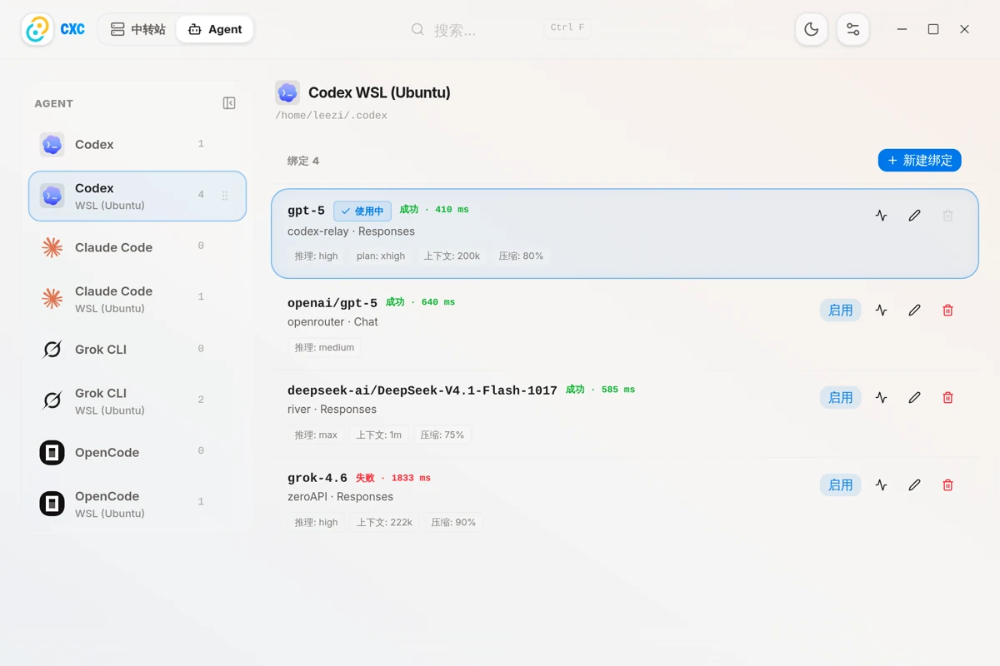

# CXC — Code Cross-Connect

简体中文 | [English](README_en.md)

> 为 Codex、Claude Code、Grok CLI、OpenCode 统一管理 API 中转站，一次配置，按 Agent 切换。

[](https://www.rust-lang.org)
[](LICENSE)



CXC 是一个管理 AI 编程工具 API 中转端点的桌面应用。中转站、账号、模型只维护一份，每个 Agent 各自选择用哪个中转站、哪个账号、哪个模型，点一下即可写入目标工具的配置文件。

## 功能特性

- **Agent = 工具 + 环境** — Codex、Claude Code、Grok CLI、OpenCode 在 WSL 与 Windows 下是各自独立的 Agent，配置互不影响。按 PATH 自动探测安装状态，不可达的环境不显示。
- **全局中转站** — 一个端点只保存一份：Base URL、协议集合、模型目录、备注。
- **多账号** — 一个中转站可以保存多个 API Key（个人 / 团队 / 备用），绑定可以选择具体账号或跟随默认账号。
- **绑定列表** — 每个 Agent 可保存多条绑定（中转站 + 账号 + 模型 + 推理档位 + 上下文 + 压缩比例），同一时刻只有一条使用中，点「启用」即切换并写入。
- **三协议探测** — 分别探测 Anthropic Messages、OpenAI Chat Completions、OpenAI Responses，自动识别中转站支持哪些协议。
- **模型选择器** — 绑定对话框内可搜索、可键盘选择、可一键刷新该中转站的模型列表；下架模型会被移除，存活模型保留测试结果。
- **连通性测试** — 对单个模型发真实推理请求并测量延迟，支持按中转站批量测试，结果记录到具体账号。
- **卡片 / 列表双视图** — 中转站页可在卡片与列表之间切换，默认列表。
- **安全写入** — 修改目标工具配置前自动生成 `.bak` 备份，写入失败时 CXC 侧配置保持不变。
- **其他** — 系统托盘、Gist 同步（可选 AES-256-GCM 加密）、明暗主题、中英文界面、自定义配置目录。

## 安装

从 [Releases](https://github.com/zhang3say/cxc/releases) 下载对应平台的安装包。

首次启动会自动接管旧版配置，详见下方「配置迁移」。

## 开发

```bash
git clone https://github.com/zhang3say/cxc
cd cxc

# 前端依赖
cd cxc-desktop
npm install

# 启动桌面端开发环境
npm run tauri dev
```

浏览器预览（内置 mock IPC，不依赖 Tauri）：

```bash
cd cxc-desktop
npm run dev
```

## 构建与测试

```bash
# 核心单元测试
cargo test -p cxc-core

# 静态检查
cargo clippy --all-targets -- -D warnings
cargo fmt --all -- --check

# 前端类型检查与构建
cd cxc-desktop
npx tsc --noEmit
npm run build

# 本地打包
npm run tauri build
```

安装包输出在 `cxc-desktop/src-tauri/target/release/bundle/`。

## 自动打包

推送 `cxc-desktop-v*` 形式的标签会触发 [`.github/workflows/desktop-release.yml`](.github/workflows/desktop-release.yml)，在 macOS（arm64 / x64）与 Windows 上构建安装包，并创建一个**草稿** Release 供人工确认后发布。

```bash
git tag cxc-desktop-v0.2.0
git push origin cxc-desktop-v0.2.0
```

## 配置文件

CXC 自身的配置存放在系统配置目录：

- Linux / WSL：`~/.config/cxc/config.yaml`
- Windows：`%APPDATA%\cxc\config.yaml`

写入目标工具时，会更新这些文件：

| 工具 | WSL / Linux | Windows |
|---|---|---|
| Codex | `~/.codex/config.toml` + `auth.json` | `%USERPROFILE%\.codex\config.toml` + `auth.json` |
| Claude Code | `~/.claude/settings.json` | `%USERPROFILE%\.claude\settings.json` |
| Grok CLI | `~/.grok/config.toml` | `%USERPROFILE%\.grok\config.toml` |
| OpenCode | `~/.config/opencode/opencode.json` | `%APPDATA%\opencode\opencode.json` |

每个工具在 WSL 与 Windows 下各有一份绑定列表，使用中的那条写入对应环境的配置文件。写入前都会生成 `.bak` 备份。

### 配置迁移

CXC 0.2.0 取代了旧的 `cxc-desktop`。首次启动按以下优先级接管数据，覆盖任何文件前都会先备份为 `config.yaml.backup.<时间戳>`：

1. 主路径已是新格式 → 直接使用。
2. 存在上一代 `cxc-v2` 配置（`~/.config/cxc-v2/config.yaml`）→ 优先接管它，因为它比旧版数据新。
3. 主路径是旧版 v1 格式（含 `codex_providers` 等字段）→ 备份后原地迁移。
4. 都没有 → 使用空配置。

迁移会把旧版三份列表按「地址 + Key」合并成全局中转站，每个 Key 变成中转站下的一个账号。

## 系统架构

- **后端（Rust）** — Tauri 2 + Tokio + Reqwest，负责探测、连通性测试、配置文件读写与同步。
- **前端（React）** — React 19 + TypeScript + Vite 7，Tailwind CSS 4 + Radix UI。
- **保留格式的 AST 修改** — Codex / Grok 的 TOML 用 `toml_edit` 修改，保留原有格式与注释。

架构决策记录见 [docs/adr/](docs/adr/)。

## 许可证

MIT
