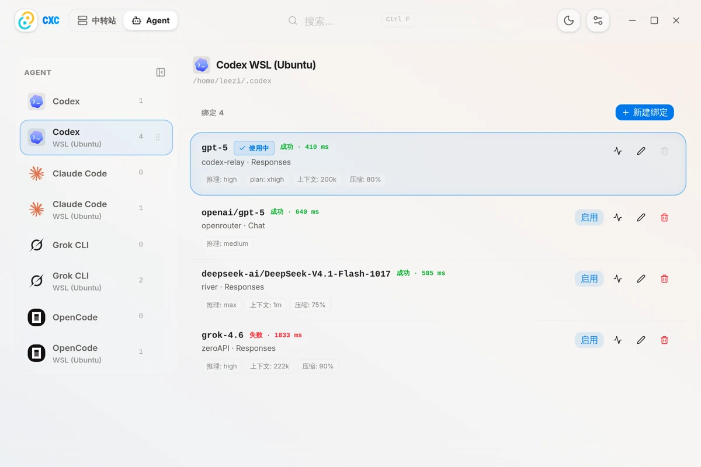
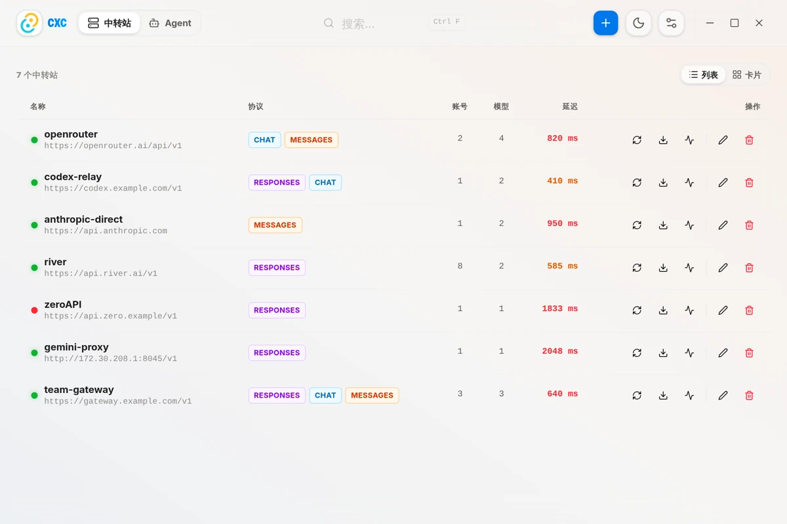
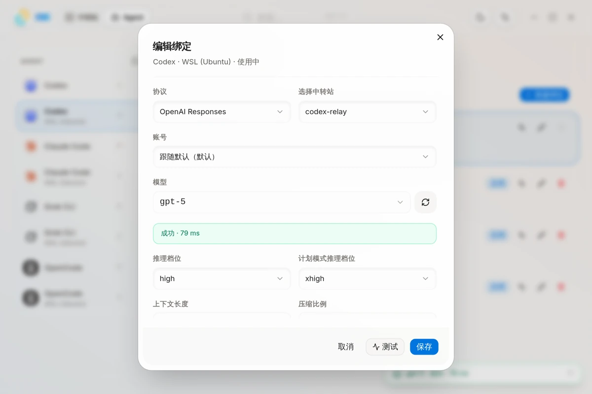

# CXC — Code Cross-Connect

[简体中文](README.md) | English

> One place to manage API relays for Codex, Claude Code, Grok CLI and OpenCode — configure once, switch per agent.

[](https://www.rust-lang.org)
[](LICENSE)



CXC is a desktop app for managing API relay endpoints used by AI coding tools. Relays, accounts and models are stored once; each agent picks which relay, which account and which model to use, and one click writes it into that tool's config file.

## Features

- **Agent = tool + environment** — Codex, Claude Code, Grok CLI and OpenCode are separate agents under WSL and Windows, with independent configuration. Install state is detected from `PATH`; unreachable environments are hidden.
- **Global relays** — One record per endpoint: base URL, protocol set, model catalog, remark.
- **Multiple accounts** — A relay can hold several API keys (personal / team / spare). A binding either picks a specific account or follows the relay default.
- **Binding list** — Each agent keeps multiple bindings (relay + account + model + reasoning effort + context length + compact ratio). Exactly one is active; activating it writes the target config file.
- **Three-protocol probing** — Probes Anthropic Messages, OpenAI Chat Completions and OpenAI Responses separately to detect what a relay supports.
- **Model picker** — Searchable, keyboard-driven, with an inline refresh for the relay's model list. Retired models are dropped; surviving models keep their test results.
- **Connectivity tests** — Sends a real inference request per model and records latency, per relay or per model, attributed to the account used.
- **Card / list views** — The relay page switches between cards and a table; list is the default.
- **Safe writes** — A `.bak` backup is created before touching any target config; a failed write leaves CXC's own config unchanged.
- **Also included** — System tray, optional Gist sync (AES-256-GCM), light/dark themes, Chinese/English UI, custom config directories.

## Screenshots

| Relays | Bindings and model tests |
| --- | --- |
|  |  |

## Install

Download the installer for your platform from [Releases](https://github.com/zhang3say/cxc/releases).

Existing configuration is taken over automatically on first launch — see [Configuration migration](#configuration-migration).

## Development

```bash
git clone https://github.com/zhang3say/cxc
cd cxc

cd cxc-desktop
npm install

npm run tauri dev
```

Browser preview (built-in mock IPC, no Tauri required):

```bash
cd cxc-desktop
npm run dev
```

## Build and test

```bash
cargo test -p cxc-core

cargo clippy --all-targets -- -D warnings
cargo fmt --all -- --check

cd cxc-desktop
npx tsc --noEmit
npm run build

npm run tauri build
```

Installers are written to `cxc-desktop/src-tauri/target/release/bundle/`.

## Automated packaging

Pushing a `cxc-desktop-v*` tag triggers [`.github/workflows/desktop-release.yml`](.github/workflows/desktop-release.yml), which builds installers on macOS (arm64 / x64) and Windows and opens a **draft** release for review.

```bash
git tag cxc-desktop-v1.0.0
git push origin cxc-desktop-v1.0.0
```

## Configuration

CXC keeps its own config in the system config directory:

- Linux / WSL: `~/.config/cxc/config.yaml`
- Windows: `%APPDATA%\cxc\config.yaml`

Writing to a target tool updates these files:

| Tool | WSL / Linux | Windows |
|---|---|---|
| Codex | `~/.codex/config.toml` + `auth.json` | `%USERPROFILE%\.codex\config.toml` + `auth.json` |
| Claude Code | `~/.claude/settings.json` | `%USERPROFILE%\.claude\settings.json` |
| Grok CLI | `~/.grok/config.toml` | `%USERPROFILE%\.grok\config.toml` |
| OpenCode | `~/.config/opencode/opencode.json` | `%APPDATA%\opencode\opencode.json` |

Each tool has one binding list per environment; the active binding is written to that environment's config file. A `.bak` backup is created first.

### Configuration migration

CXC 0.2.0 replaces the old `cxc-desktop`. On first launch data is taken over in this order, and any file that would be overwritten is first backed up as `config.yaml.backup.<timestamp>`:

1. The main path already holds the new format → used as-is.
2. A previous-generation `cxc-v2` config exists (`~/.config/cxc-v2/config.yaml`) → taken over, because it is newer than the legacy data.
3. The main path holds the legacy v1 format (`codex_providers` etc.) → backed up and migrated in place.
4. Nothing found → empty configuration.

Migration merges the old per-tool provider lists into global relays keyed by address + API key, turning each key into an account on that relay.

## Architecture

- **Backend (Rust)** — Tauri 2 + Tokio + Reqwest for probing, connectivity tests, config file I/O and sync.
- **Frontend (React)** — React 19 + TypeScript + Vite 7, Tailwind CSS 4 + Radix UI.
- **Format-preserving AST edits** — Codex / Grok TOML files are edited with `toml_edit`, keeping formatting and comments.

Architecture decisions live in [docs/adr/](docs/adr/).

## License

MIT
